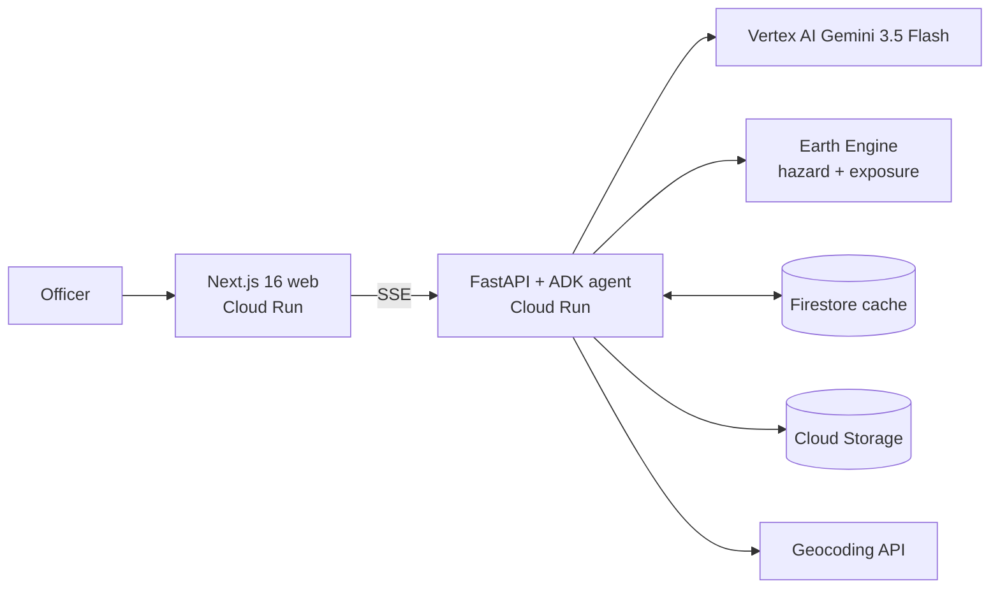

# LandslideWatch TH

**Ask "what if it rains 250 mm in three days in Mae Hong Son?" and get a hazard map plus who and what is exposed, in under 20 seconds.**

Built for the Google Cloud AI Builder Cup 2026 (JAPAC). A Gemini agent (ADK) turns a disaster officer's plain-language question, in English or Thai, into Earth Engine analysis: a landslide hazard map, estimated people, households, buildings, road kilometres and critical facilities in the danger zones, and the top-ranked sub-districts (tambon). Every number comes from a tool call, never from the model's memory.

> Screening tool, **not an official forecast or warning.** Follow TMD and DDPM. See [docs/limitations.md](docs/limitations.md).

## Features
- Natural-language what-if scenarios (rainfall mm, duration), compare scenarios (150 vs 300 mm), and "this week" forecast risk using IMERG antecedent rain plus GFS forecast.
- Place resolution for all 77 provinces, plus districts and sub-districts once the admin index is built; Thai and English, typo tolerant, asks one clarifying question when a name is ambiguous, rejects places outside Thailand.
- Hazard layer on Google Maps, legend and opacity, click-to-explain a point, facility markers, rainfall slider that re-runs instantly.
- KPI tiles, top-10 sub-district chart, exportable briefing, data sources and limitations shown with every result.
- Runs with **zero cloud access** in mock mode; one command to go live.

## Architecture



Details, request sequence, caching and performance budget: [docs/architecture.md](docs/architecture.md). Method and weights: [docs/method.md](docs/method.md). Data sources with verified IDs: [docs/data_sources.md](docs/data_sources.md).

## Quick start (local, mock mode, no cloud)

Needs Python 3.12 + [uv](https://docs.astral.sh/uv/) and Node 20+ with pnpm.

```bash
cp .env.example .env                      # GEO_BACKEND=mock is the default
cd apps/api && uv run pytest -q           # tests
cd apps/api && uv run uvicorn app.main:app --port 8080 --reload
cd apps/web && pnpm install && pnpm dev   # http://localhost:3000
```
Mock mode uses deterministic fixtures for hazard/exposure, so the UI and API contract work offline. The chat agent itself needs Vertex AI credentials; without them use the slider/`POST /scenario` path. Or run everything with `make dev` (docker compose, mounts your ADC).

## Deploy (real Earth Engine + Vertex)

Follow the ordered **PLUG-IN CHECKLIST** in [docs/config-reference.md](docs/config-reference.md). Short form:

```bash
cp infra/config.env.example infra/config.env && cp .env.example .env   # fill PROJECT_ID, EE_PROJECT, Maps key
gcloud auth application-default login --scopes=https://www.googleapis.com/auth/earthengine,https://www.googleapis.com/auth/cloud-platform
export MAPS_KEY=<browser key>
infra/bootstrap.sh                        # prerequisites, APIs, service account, Firestore, bucket, secret
infra/bootstrap.sh --run-pipeline         # admin upload, OSM, susceptibility + exposure exports (long)
API_URL=<api url> MAPS_KEY=$MAPS_KEY MAP_ID=<map id> make deploy
python infra/smoke_test.py https://<api-url>
```

## Demo script (three rehearsed scenarios)

Pre-warm these once after deploy so results are cached.

1. **"What happens with 250 mm of rain in 3 days in Mae Hong Son?"** Map draws; KPIs: people and households in High/Very High, buildings, road km, schools and hospitals; top tambon chart. Click a red cell to show the explanation (slope, land cover, stream distance).
2. **"Compare 150 mm vs 300 mm in Nan."** Compare table and chart; drag the slider to show instant re-run. Point out how exposure grows non-linearly.
3. **"What is the risk this week in Chiang Mai?"** Agent uses IMERG antecedent rain and the GFS forecast, states the assumptions, and refers to TMD/DDPM for official warnings.

Extra beats if asked: Thai prompt ("ฝน 200 มม. ใน 2 วัน ที่ น่าน"), an ambiguous tambon name (agent asks one question), "Tokyo" (politely refused: outside Thailand).

## 2-3 minute video script

| Time | Screen | Voice-over |
|---|---|---|
| 0:00-0:15 | Photo/clip of a landslide, then the app | "Every monsoon, officers in northern Thailand ask the same question: if this much rain falls, who is at risk? Today that takes days of GIS work." |
| 0:15-0:35 | Type scenario 1 | "LandslideWatch TH answers in seconds. I ask in plain English: 250 millimetres in three days in Mae Hong Son." |
| 0:35-1:05 | Status chips, map layer, KPI tiles | "A Gemini agent built with ADK plans the analysis and calls Earth Engine. NASADEM slope, land cover, soils and streams give susceptibility; a rainfall-threshold model turns the scenario into hazard. Exposure from WorldPop, buildings and OpenStreetMap. Every number you see came from a tool call." |
| 1:05-1:30 | Click map point, explain | "Click anywhere to see why it is red: steep slope, bare ground, close to a stream." |
| 1:30-1:55 | Scenario 2: compare, slider | "Planning? Compare 150 against 300 millimetres, or drag the slider and re-run instantly." |
| 1:55-2:20 | Scenario 3 + Thai toggle | "This week's risk uses satellite rainfall from the past fortnight and the GFS forecast. It works in Thai too, and always points to TMD and DDPM for official warnings." |
| 2:20-2:45 | Limitations panel, architecture slide | "We are upfront: screening level, uniform rainfall, estimated households. Runs on Cloud Run, Vertex AI, Earth Engine and Firestore. Built to be handed to the people who need it." |

## Prize categories

| Category | How we fit |
|---|---|
| **Best Use of Google Cloud AI Tools** | ADK agent on Gemini 3.5 Flash (Vertex AI) with typed tools and streamed events; Earth Engine does all geospatial compute; Firestore, Cloud Run, Cloud Build, Secret Manager, Geocoding and Maps in one coherent stack. |
| **Most Impactful** | Turns a days-long GIS task into seconds for provincial disaster staff in a landslide-prone country; transparent method; extensible to other hazards and countries; built on open data. |
| **Social Choice** | Relatable, high-stakes question ("will my district be hit?"), bilingual Thai/English, shareable briefing. |
| **Best UI/UX** | Chat plus map split view, tool-progress chips, KPI tiles, slider re-run, colour-blind safe ramp, dark/light, mobile tabs, clear empty/error states, persistent honesty banner. |

## Screenshots

_Placeholders; add after the first deploy._

| | |
|---|---|
| `docs/img/hero.png` Chat + hazard map (Mae Hong Son) | `docs/img/compare.png` 150 vs 300 mm compare |
| `docs/img/explain.png` Click-to-explain popover | `docs/img/mobile.png` Mobile tabs |

## Safety and honesty

- **Not an official warning.** A persistent banner links to TMD and DDPM; the agent refers users there for decisions.
- **Numbers only from tools.** The system prompt forbids figures from memory; people are rounded; households are labelled estimates (people / 2.5).
- **Assumptions are always shown**: uniform rainfall, 100 m resolution, no soil depth or lithology, global rainfall threshold not calibrated to Thailand.
- **Data caveats are visible** in each result (`data_sources`, `limitations`), see [docs/data_sources.md](docs/data_sources.md).
- **Validation is reported, not claimed.** `scripts/validate_susceptibility.py` computes AUC against NASA GLC; quote only what it outputs.
- Out-of-scope requests (places outside Thailand, absurd rainfall) are refused with an explanation.

## Layout

`apps/web` Next.js UI, `apps/api` FastAPI + ADK + geo (`app/geo`, `app/agent`, `app/config`), `scripts` one-time data pipeline, `infra` setup/bootstrap/smoke test, `docs`, `evals`, `infra/cloudbuild-*.yaml`, `docker-compose.yml`, `Makefile`.
