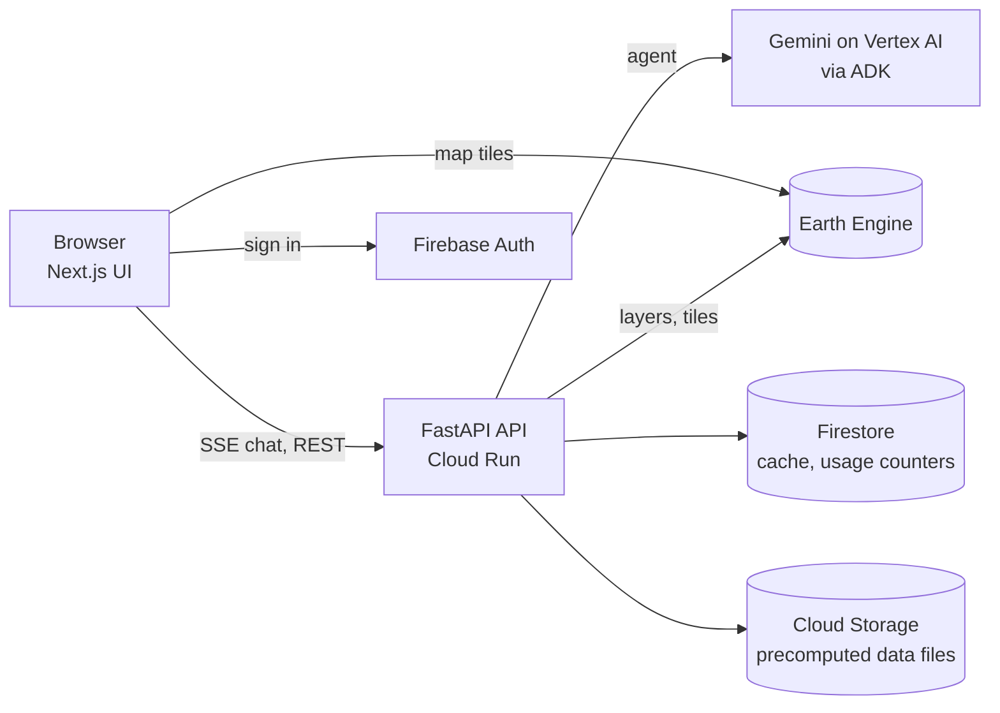

# DNext

[](https://github.com/Kamalh27/dnext/actions/workflows/ci.yml)

DNext is a landslide risk screening tool for Thailand. It combines observed and forecast rainfall with national susceptibility, vulnerability and exposure data to show, province by province and tambon by tambon, where rain is likely to trigger landslides and how many people, buildings, hospitals, schools and kilometres of road lie in the higher-risk zones.

You can ask questions in English or Thai ("What if Nan gets 250 mm in three days?"), run what-if rainfall scenarios, and follow a five-day risk forecast on the map.

It is a screening tool for planning and situational awareness, not a forecast or warning service. Confirm results locally before acting. See [docs/limitations.md](docs/limitations.md).

## What it does

- **National overview.** The first screen colours the provinces by risk, with a five-day slider for forecast risk or rainfall and a dashboard of key figures, trends and the most affected provinces.
- **Province and tambon detail.** Pick a province from the list or the map, then run a rainfall what-if or a forecast. You get risk, rainfall and trigger layers, a ranked tambon table, and people, buildings, hospitals, schools and main roads in the risk zone.
- **Report and sharing.** The Report button next to the province picker opens a report editor with a branded layout: risk, 30-day rainfall and rainfall-trigger maps by tambon (or risk, daily rain and trigger share by province for the national overview), numbered priority areas, key figures with icons, charts, tables, the hospitals and schools at risk and general safety guidance. Every piece of text can be edited before you click Export PDF, which saves the page through the browser's print dialog in English or Thai. It covers the result on screen or, when nothing is selected, the national overview for the day on the slider. A copy-link button on a result gives an address that runs the same scenario or forecast again.
- **Hospitals and schools at risk.** Named hospitals and schools from OpenStreetMap that sit on susceptible ground in tambons above their rainfall trigger are listed in a table and marked on the map, with their risk class.
- **Affected infrastructure.** For the result on screen the map can show the buildings and main-road sections inside the Moderate-or-higher risk zone (Low is left out), coloured by risk, plus the hospitals and schools at that level. Each group has a switch. From street-level zoom buildings are drawn as footprints and, with the 3D switch on, as extruded blocks on a tilted map (deck.gl on the Google map, loaded only when needed).
- **Reference layers.** Susceptibility, vulnerability, exposure, population and province boundaries can each be switched on the map.
- **Chat history.** Conversations are saved in the browser and, for signed-in users, in Firestore for 90 days. Scenario runs from the sliders are noted in the conversation, and the assistant knows about the result on screen, so follow-ups like "what about 400 mm?" work.
- **30-day trend and alerts.** Each day's risk per province and tambon is appended to BigQuery by the daily job, which gives a 30-day trend for the selected province. Signed-in users can watch provinces and get an in-app alert (and optionally an email) when the risk of a watched province rises. The job announces new data through Pub/Sub.
- **Photo check.** Take or choose a photo of a slope or road and Gemini describes the warning signs it can see next to the computed risk of the area. The photo is resized on the device, looked at once and not stored.
- **Chat assistant.** Gemini, running through Google's Agent Development Kit, answers in English or Thai. Every number comes from a computed result, not from the model.
- **Sign-in with daily limits (optional).** Firebase Authentication with Google accounts, with a daily budget per account to keep Gemini costs under control on a public deployment.
- **Phone to widescreen.** English and Thai, light and dark themes.

## How it works

The risk for a tambon is

```
risk = trigger × susceptibility × vulnerability × exposure ÷ 125
```

on a scale of 0 to 5. The trigger compares the tambon's 30-day rainfall with that tambon's own rainfall thresholds. The other three factors come from national layers. [docs/risk_method.md](docs/risk_method.md) has the details.

Rainfall comes from JAXA GSMaP (observed) and NOAA GFS (forecast). A what-if amount is added to the observed rain of the preceding days to form the 30-day total.

Most of the work is done ahead of time. Daily rainfall per tambon and two tables of per-tambon statistics are precomputed into small files, so a scenario needs a few milliseconds of Python plus map tiles from Earth Engine, and a request takes roughly 1 to 8 seconds.

Data comes from ADPC layers accessed through Google Earth Engine, WorldPop, GHSL built-up area, OpenStreetMap (hospitals, schools, main roads) and Google Maps. See [docs/data_sources.md](docs/data_sources.md).



## Repository layout

| Path | Contents |
|---|---|
| `apps/web` | Next.js 16 UI (React 19, Tailwind 4, Google Maps, Recharts) |
| `apps/api` | FastAPI service: ADK agent (`app/agent`), geospatial logic (`app/geo`), YAML config (`app/config`), tests |
| `scripts` | Data precompute scripts and the secret check |
| `infra` | Cloud setup, deploy and Cloud Build configuration, smoke test |
| `docs` | Method, data sources, configuration, architecture, limitations |
| `evals` | Agent evaluation set and test harness |
| `.github/workflows` | CI: tests, build and secret scan |

## Setup

### Prerequisites

Python 3.12 with [uv](https://docs.astral.sh/uv/), Node 20 or newer (CI uses 24) with pnpm 10, and optionally [just](https://github.com/casey/just), the Google Cloud CLI and Docker.

### 1. Run locally without a cloud account

```bash
just setup      # installs API and web dependencies, creates .env and apps/web/.env.local from the templates
just dev        # API on :8080 and web on :3000, using the mock data backend
just test       # API tests
just web-check  # web type-check and lint
```

Without `just`: `cd apps/api && uv sync && uv run uvicorn app.main:app --reload --port 8080`, then `cd apps/web && pnpm install && pnpm dev`.

The default `GEO_BACKEND=mock` serves fixed test data, so the UI and API run offline. The chat assistant itself needs Vertex AI access (step 2).

### 2. Connect your Google Cloud project

1. Use a Google Cloud project with billing enabled and [register it for Earth Engine](https://code.earthengine.google.com/register).
2. Create a service account and save its JSON key as `credentials/ee-sa.json`. That folder is gitignored. You can use `gcloud auth application-default login` instead. [credentials/README.md](credentials/README.md) lists the roles it needs.
3. Create a Google Maps API key restricted to your site, and a Map ID (choose vector rendering to get 3D tilt).
4. Copy `apps/api/app/config/risk_layers.local.yaml.example` to `risk_layers.local.yaml` and fill in the Earth Engine paths of the ADPC layers (see [docs/data_sources.md](docs/data_sources.md)). The paths are specific to your project, so the file is gitignored.
5. Edit `.env`:

| Variable | Purpose |
|---|---|
| `PROJECT_ID`, `EE_PROJECT`, `REGION` | Your Cloud project and region |
| `GEO_BACKEND` | `mock` for test data or `ee` for real Earth Engine data |
| `EE_SERVICE_ACCOUNT_KEY` | Path to the key, for example `credentials/ee-sa.json` |
| `AGENT_MODEL`, `GOOGLE_CLOUD_LOCATION` | Gemini model and Vertex AI location |
| `NEXT_PUBLIC_GOOGLE_MAPS_API_KEY`, `NEXT_PUBLIC_GOOGLE_MAP_ID` | Map key and Map ID for the browser (also in `apps/web/.env.local`) |
| `NEXT_PUBLIC_FEEDBACK_FORM_URL` | Link to your feedback form, opened by the header's feedback button |

All settings are listed in [docs/config-reference.md](docs/config-reference.md).

### 3. Build the data files

Run these from `apps/api`. Scripts that read OpenStreetMap need `--group scripts`. Output goes to `apps/api/.local_storage/risk/`, which is gitignored.

```bash
# one-off; repeat only if the source layers change
uv run python ../../scripts/build_risk_layer.py --project <EE_PROJECT>      # exports a 100 m asset to your Earth Engine project
uv run python ../../scripts/precompute_static_stats.py                      # per-tambon risk statistics
uv run python ../../scripts/build_provinces_geojson.py                      # province outlines for the map
uv run --group scripts python ../../scripts/precompute_features.py          # buildings, hospitals, schools, roads (needs a Geofabrik extract; see the script header)
uv run --group scripts python ../../scripts/precompute_facilities.py        # named hospitals and schools at risk (same extract)
uv run --group scripts python ../../scripts/build_tambon_shapes.py          # tambon outlines for the report map
uv run --group scripts python ../../scripts/precompute_infrastructure.py    # buildings and main roads on ground that can reach Moderate risk (about 10 minutes)

# daily: rainfall
uv run python ../../scripts/precompute_rain.py
```

The daily file has to stay fresh (step 5 schedules it in the cloud). If the observed data is more than 3 days old the overview is unavailable, and if the forecast run is more than 36 hours old the dashboard shows observed conditions only.

### 4. Sign-in and per-account limits (optional)

Add Firebase to your Cloud project, enable the Google provider under Authentication, add your site to the authorised domains and register a web app. Put its public config in `.env` (`FIREBASE_API_KEY`, `FIREBASE_AUTH_DOMAIN`, `FIREBASE_APP_ID`) and set `AUTH_REQUIRED=true`.

Chat, scenarios and forecasts then need a Google sign-in. The default limits are 30 chats and 200 runs per account per day. The map and the overview stay public.

### 5. Deploy to Cloud Run

```bash
cp infra/config.env.example infra/config.env    # PROJECT_ID, REGION, EE_PROJECT (gitignored)
infra/setup.sh                                  # APIs, service accounts, Artifact Registry, Firestore, bucket
infra/bootstrap.sh                              # stores the Maps keys in Secret Manager
just deploy                                     # builds and deploys the API, then the web app, then runs the smoke test
```

The API runs under an attached service account, so there is no key file in the image. If your project cannot create more service accounts, set `RUNTIME_SA` in `infra/config.env` to an existing one and `setup.sh` will use it instead.

The data files from step 3 must also be in the project's bucket, under `gs://<project>-dnext/risk/`, because the container does not include them. After the first deploy, `just deploy-alerts` creates the BigQuery dataset, the Pub/Sub topic and the push subscription that lets the job trigger alerts.

`just deploy-job` builds the daily rainfall job and schedules it with Cloud Scheduler for 06:30 and 18:30 Bangkok time, so the overview stays fresh without anyone running a script. Add `--run-now` (`bash infra/deploy-job.sh --run-now`) to run it once straight away.

After the first deploy, add the web address to the Maps key's allowed websites and to Firebase's authorised domains.

## Tests and CI

- `just test` runs the API tests, `just web-check` the web checks, `just test-ee` the cloud integration tests (credentials needed) and `just eval` the agent evaluations (Gemini needed).
- GitHub Actions (`.github/workflows/ci.yml`) runs on every push and pull request: API tests, web type-check, lint, unit test and production build, infra script checks, Docker image builds, and a secret scan of files and history.

## Secrets

`.env`, `credentials/`, service-account keys, `.local_storage/` and generated project config such as `risk_layers.local.yaml` are gitignored and must not be committed. `scripts/check-secrets.sh` fails CI when it finds a secret, a credential file or a project-specific Earth Engine path in tracked files. To run it before every local commit, enable the hook once per clone:

```bash
git config core.hooksPath .githooks
```

## Documentation

[Risk method](docs/risk_method.md) · [Data sources](docs/data_sources.md) · [Configuration reference](docs/config-reference.md) · [Limitations](docs/limitations.md) · [Architecture](docs/architecture.md) · [Event contract](docs/event_contract.md) · [Alternative screening method](docs/method.md)

## Notes on the results

- Results are screening estimates for planning, not forecasts or warnings.
- People and buildings are rounded estimates, and building counts come from satellite built-up area.
- Risk classes are national and relative, not probabilities.
- OpenStreetMap data for hospitals, schools and roads can be incomplete.
- Places outside Thailand, and rainfall amounts above the configured limit, are declined with an explanation.
