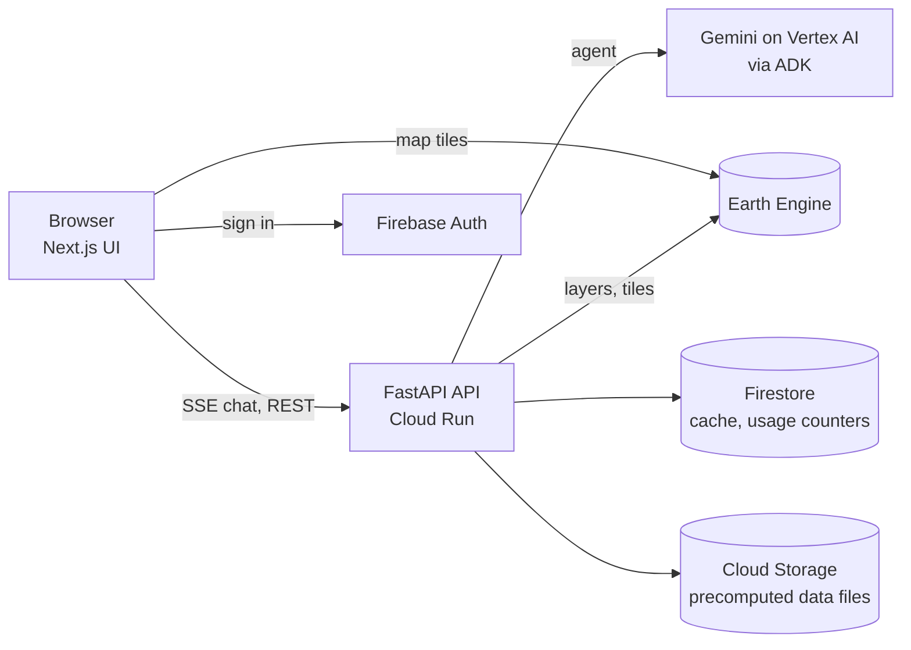

# DNext · LandslideWatch TH

[](https://github.com/Kamalh27/dnext/actions/workflows/ci.yml)

A landslide risk screening tool for Thailand. It combines Thailand's rainfall (observed and forecast) with the DMR/ADPC landslide risk method to show, at province and tambon (sub-district) level, where rain is likely to trigger landslides and how many people, buildings, hospitals, schools and roads are in the danger zones. You can ask questions in English or Thai ("What if Nan gets 250 mm in three days?"), run what-if rainfall scenarios, and follow a 5-day risk forecast on a map.

> A screening tool for planning and situational awareness, not a forecast or warning service. Confirm results locally before acting. See [docs/limitations.md](docs/limitations.md).

## What it does

- **National overview (default screen):** provinces coloured by landslide risk, a 5-day forecast slider (risk or rainfall), and a dashboard of key figures, trends and top provinces.
- **Province and tambon detail:** pick a province from a list or by clicking the map, then run a rainfall what-if or a forecast. You get risk, rainfall and trigger layers, a ranked tambon table, and people, buildings, hospitals, schools and main roads in the risk zone.
- **Reference layers:** susceptibility, vulnerability, exposure, population and province boundaries, each switchable on the map.
- **Chat assistant (Gemini via Google ADK):** answers in English or Thai. Every number comes from a computed tool result, never from the model's memory.
- **Optional sign-in (Firebase Authentication, Google) with per-account daily limits**, to protect the Gemini cost of a public deployment.
- **Responsive and bilingual UI:** phone, tablet, laptop and wide screens; English and Thai; light and dark themes.

## How it works

- **Method (DMR/ADPC):** `risk = trigger × susceptibility × vulnerability × exposure ÷ 125` (range 0–5). The trigger compares each tambon's 30-day rainfall with that tambon's own DMR percentile thresholds. Susceptibility is ADPC's static map. Details: [docs/dmr_method.md](docs/dmr_method.md).
- **Rainfall:** JAXA GSMaP (observed) plus NOAA GFS (forecast). A what-if rainfall is added to the observed rain of the preceding days to form the 30-day total.
- **Speed:** the heavy work is precomputed into small data files (daily rainfall per tambon; a one-off statistics table; a one-off table of buildings, facilities and roads by risk zone). A scenario then needs only a few milliseconds of Python plus map tiles from Earth Engine, so a request takes roughly 1–8 seconds.
- **Sources:** public Earth Engine assets (DMR/ADPC layers, WorldPop, GHSL built-up area), OpenStreetMap (hospitals, schools, main roads), Google Maps. See [docs/data_sources.md](docs/data_sources.md).



## Repository layout

| Path | What is in it |
|---|---|
| `apps/web` | Next.js 16 UI (React 19, Tailwind 4, Google Maps, Recharts) |
| `apps/api` | FastAPI service: ADK agent (`app/agent`), geospatial logic (`app/geo`), YAML config (`app/config`), tests |
| `scripts` | One-off and daily data precompute scripts, secret check |
| `infra` | Cloud setup, deploy and Cloud Build configs, smoke test |
| `docs` | Method, data sources, configuration, architecture, limitations |
| `evals` | Agent evaluation set and test harness |
| `.github/workflows` | CI (tests, build, secret scan) |

## Setup

### Prerequisites

Python 3.12 with [uv](https://docs.astral.sh/uv/), Node 20+ (CI uses 24) with pnpm 10, and optionally [just](https://github.com/casey/just), the Google Cloud CLI and Docker.

### 1. Run locally, no cloud account needed

```bash
just setup      # installs API and web dependencies; creates .env and apps/web/.env.local from the templates
just dev        # API on :8080 and web on :3000 (mock data backend)
just test       # API tests
just web-check  # web type-check and lint
```

Without `just`: `cd apps/api && uv sync && uv run uvicorn app.main:app --reload --port 8080`, and `cd apps/web && pnpm install && pnpm dev`.

The default `GEO_BACKEND=mock` serves deterministic fixtures so the UI and API run offline. The chat assistant itself needs Vertex AI access (step 2).

### 2. Connect your Google Cloud project (real data)

1. Choose or create a Google Cloud project with billing, and register it for [Earth Engine](https://code.earthengine.google.com/register).
2. Create a service account, grant it the roles it needs (`infra/setup.sh` lists them), and save its JSON key as `credentials/ee-sa.json`. That folder is gitignored. Alternatively use `gcloud auth application-default login`.
3. Create a Google Maps API key (restricted to your site) and a Map ID (choose *Vector* rendering to enable the 3D tilt).
4. Copy `apps/api/app/config/dmr_assets.local.yaml.example` to `dmr_assets.local.yaml` and fill in the Earth Engine paths of the DMR/ADPC layers (see [docs/data_sources.md](docs/data_sources.md)). The file is gitignored because the paths are project-specific.
5. Edit `.env`:

| Variable | Purpose |
|---|---|
| `PROJECT_ID`, `EE_PROJECT`, `REGION` | Your Cloud project and region |
| `GEO_BACKEND` | `mock` (fixtures) or `ee` (real Earth Engine) |
| `EE_SERVICE_ACCOUNT_KEY` | Path to the key, e.g. `credentials/ee-sa.json` |
| `AGENT_MODEL`, `GOOGLE_CLOUD_LOCATION` | Gemini model and Vertex location |
| `NEXT_PUBLIC_GOOGLE_MAPS_API_KEY`, `NEXT_PUBLIC_GOOGLE_MAP_ID` | Browser map key and Map ID (in `apps/web/.env.local`) |

All settings are listed in [docs/config-reference.md](docs/config-reference.md).

### 3. Build the data files

Run from `apps/api` (scripts that read OpenStreetMap need `--group scripts`). Outputs go to `apps/api/.local_storage/dmr/`, which is gitignored.

```bash
# one-off (re-run only if the source layers change)
uv run python ../../scripts/build_dmr_static.py --project <EE_PROJECT>    # exports a 100 m asset to your Earth Engine project
uv run python ../../scripts/precompute_dmr_static_stats.py                 # per-tambon risk statistics
uv run python ../../scripts/build_provinces_geojson.py                     # province outlines for the map
uv run --group scripts python ../../scripts/precompute_dmr_features.py     # buildings, hospitals, schools, roads (needs the Geofabrik extract, see the script header)

# daily (rainfall)
uv run python ../../scripts/precompute_dmr_rain.py
```

The daily file must stay fresh. If observed data is more than 3 days old the overview is unavailable; if the forecast run is more than 36 hours old the dashboard shows only the latest observed conditions.

### 4. Optional: sign-in and per-account limits

Add Firebase to your Cloud project, enable the **Google** sign-in provider in Authentication, add your site to the authorised domains, register a Web app, and put its public config in `.env` (`FIREBASE_API_KEY`, `FIREBASE_AUTH_DOMAIN`, `FIREBASE_APP_ID`). Then set `AUTH_REQUIRED=true`. Chat and scenario/forecast runs then need a Google sign-in (default limits: 30 chats and 200 runs per account per day; the map and overview stay public).

### 5. Deploy to Cloud Run

```bash
cp infra/config.env.example infra/config.env    # PROJECT_ID, REGION, EE_PROJECT (gitignored)
infra/setup.sh                                  # enable APIs, service account, Artifact Registry, Firestore, bucket
infra/bootstrap.sh                              # stores the Maps keys in Secret Manager
just deploy                                     # builds and deploys the API, then the web app, then smoke-tests
```

The API runs as an attached service account, with no key file in the image. In production the data files from step 3 must be in the project's Cloud Storage bucket (`<project>-dnext/dmr/`), because the container does not contain them. Automating the daily rainfall job (for example a Cloud Run job on a schedule) is not set up yet.

## Tests and CI

- `just test` (API), `just web-check` (web), `just test-ee` (cloud integration tests, needs credentials), `just eval` (agent evals, needs Gemini).
- GitHub Actions (`.github/workflows/ci.yml`) runs on every push and pull request: API tests, web type-check, lint, unit test and production build, infra script checks, Docker image builds, and a secret scan of files and history.

## Secrets

`.env`, `credentials/`, service-account keys, `.local_storage/` and generated project config are gitignored and must never be committed. `scripts/check-secrets.sh` fails CI if a secret or credential file appears in any file or commit. To run it before each local commit, enable the hook once per clone:

```bash
git config core.hooksPath .githooks
```

## Documentation

[DMR method](docs/dmr_method.md) · [Data sources](docs/data_sources.md) · [Configuration reference](docs/config-reference.md) · [Limitations](docs/limitations.md) · [Architecture](docs/architecture.md) · [Event contract](docs/event_contract.md) · [Screening model (alternative)](docs/method.md)

## Safety and honesty

- Results are screening estimates for planning, not forecasts or warnings.
- Numbers shown come from computed results. People and buildings are rounded estimates, and building counts come from satellite built-up area.
- Risk classes are national and relative, not probabilities.
- OpenStreetMap hospital, school and road data can be incomplete.
- Requests for places outside Thailand, or absurd rainfall values, are declined with an explanation.
