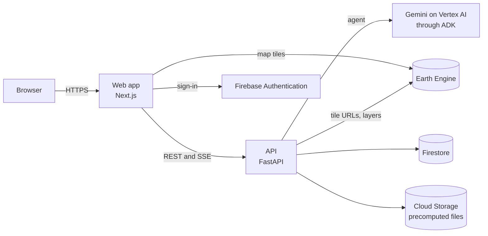

# Architecture

DNext has two Cloud Run services and a handful of managed Google services.

- **Web app** (`apps/web`): the map, the chat panel and the national dashboard. It talks to the API over REST and, for chat, Server-Sent Events.
- **API** (`apps/api`): FastAPI service. It runs the chat agent, computes scenarios and forecasts, and serves the dashboard data.
- **Earth Engine** draws the map layers. The API asks it for tile URLs and the browser loads the tiles directly.
- **Firestore** holds cached scenario results (`scenarios`) and the per-account usage counters (`usage`). Both collections have a TTL on `expires_at`.
- **Cloud Storage** holds the precomputed data files described below.
- **BigQuery** (dataset `dnext`) holds the daily history: `province_daily` and `tambon_daily`, partitioned by date. The daily job appends to them and the API reads a province's 30-day trend from `province_daily`.
- **Pub/Sub** carries one message per job run (`dnext-new-data`). A push subscription calls `POST /internal/new-data` on the API with a Google-signed token; the API compares each province's peak risk class with the previous run and notifies the accounts that watch a province that got riskier (Firestore `watchlists`, `alerts`).
- **Gemini vision** describes one uploaded photo (`POST /photo-check`): the image is analysed in memory and never stored.
- **Firebase Authentication** (Google provider) handles sign-in. The API only checks the ID token.
- **Saved chats** live in the browser (local storage, up to 30) and, for a signed-in account, in Firestore (`chats/{account}/threads`, 90-day TTL). The agent's own working memory is held by the API process only, so a reopened chat sends its last turns along once.

## Where the speed comes from

Computing statistics straight from the 12 m source layers took 34 to 81 seconds per request, so the expensive parts are done ahead of time.

| File | Produced by | Contents | Refreshed |
|---|---|---|---|
| `obs_daily.json` | `scripts/precompute_rain.py` | Daily observed and forecast rainfall per tambon | Daily |
| `static_stats.json` | `scripts/precompute_static_stats.py` | Area and population per tambon for each value of the static risk product | Once |
| `static_features.json` | `scripts/precompute_features.py` | Built-up area, hospitals, schools and road length per tambon and risk product | Once |
| `facilities.json` | `scripts/precompute_facilities.py` | Named hospitals and schools with their location, tambon and risk product | Once |
| `infrastructure.json` | `scripts/precompute_infrastructure.py` | Buildings (Google Open Buildings, with footprint area and an estimated height) and main-road pieces (OpenStreetMap) on ground that can reach Moderate risk, per tambon. About 1 MB | Once |
| `tambon_shapes.json` | `scripts/build_tambon_shapes.py` | Simplified tambon outlines by province, for the report map | Once |

The daily file is rebuilt by a Cloud Run job (`dnext-rain`) that Cloud Scheduler starts at 06:30 and 18:30 Bangkok time (`infra/deploy-job.sh`).

The static risk product is the rain-independent part of the risk (susceptibility class × vulnerability class × exposure class). It is also exported once as a 100 m Earth Engine asset (`scripts/build_risk_layer.py`).

A scenario then only has to work out each tambon's trigger class from its rainfall, which is arithmetic on the daily file, and look up the matching rows in the static files. A named facility is at risk when its tambon's trigger class times its risk product, divided by 125, reaches the lowest risk class. Only the map layer comes from Earth Engine, so requests finish in roughly 1 to 8 seconds.

The API reads the files from `apps/api/.local_storage/risk/` when they exist there, and otherwise from `gs://<project>-dnext/risk/`. On Cloud Run the container has no local copy, so the files must be in the bucket.

## What happens on a chat question

1. The browser posts the message to `POST /chat`.
2. The ADK agent (Gemini) decides which tools to call: `resolve_area`, `get_hazard_scenario`, `get_forecast_hazard`, `get_exposure`, `compare_scenarios`, `explain_cell_or_village` or `generate_briefing`.
3. The geo service runs the tool. A scenario result is cached in Firestore under a hash of the area, rainfall, duration and date. Forecasts are kept for 24 hours and what-if scenarios for 30 days.
4. The API turns each tool result into typed SSE events (status, map layers, table, chart, KPIs). The UI draws these directly and never parses the model's text. See [event_contract.md](event_contract.md).
5. The model writes a short summary from the tool results. The prompt forbids numbers that did not come from a tool.

The rainfall slider, the forecast and the dashboard call REST endpoints directly (`/scenario`, `/forecast`, `/overview`, `/overview/series`) and skip the model.

## Sign-in and limits

When `AUTH_REQUIRED=true`, chat, scenarios and forecasts need a Google sign-in. Each account has a daily budget (30 chats and 200 runs by default) and a per-minute burst limit. Counters live in Firestore under a hashed account ID and reset at midnight Thailand time. The map, the overview and the layer endpoints stay public.

## Security

- On Cloud Run the API uses an attached service account, so no key file is baked into the image.
- The Maps browser key is limited by HTTP referrer. The server-side geocoding key lives in Secret Manager.
- CORS is limited to `ALLOWED_ORIGINS`, request bodies are capped, and requests time out after 60 seconds (chat streams excepted).
- Project-specific Earth Engine layer paths and credentials stay out of git. See [config-reference.md](config-reference.md).
