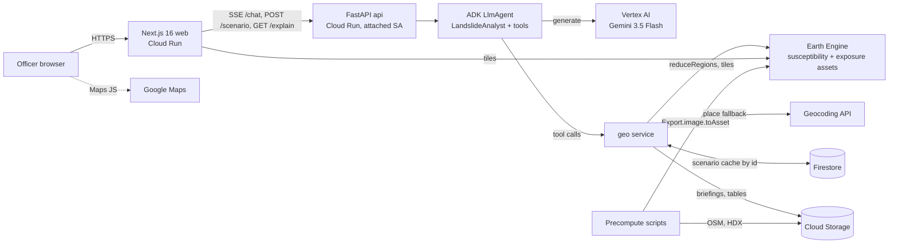

# Architecture



## What-if request sequence

```mermaid
sequenceDiagram
  participant B as Browser
  participant API as FastAPI /chat
  participant AG as ADK agent
  participant LLM as Gemini 3.5 Flash
  participant G as geo service
  participant EE as Earth Engine
  participant FS as Firestore
  B->>API: POST /chat "250 mm in 3 days in Mae Hong Son"
  API->>AG: Runner.run_async (SSE streaming)
  AG->>LLM: prompt + tools
  LLM-->>AG: call resolve_area("Mae Hong Son")
  AG->>G: resolve (admin_index.json, fuzzy)
  API-->>B: status resolving_place
  LLM-->>AG: call get_hazard_scenario(area, 250, 72)
  AG->>G: run_scenario
  G->>FS: lookup sha256(area, rain, duration, date)
  alt cache miss
    G->>EE: H = f(S, TR, W); one grouped reduceRegions over tambon
    EE-->>G: class areas, people, buildings, roads, facilities
    G->>FS: store result by scenario_id
  end
  G-->>AG: result + map tile URL
  API-->>B: map_layer, kpis, table, chart
  AG->>LLM: tool results
  LLM-->>AG: summary text (numbers from tools only)
  API-->>B: text_delta ... final
  Note over B,API: slider re-run: POST /scenario directly, then agent summary
```

The UI never parses prose: `app/agent/stream.py` maps ADK events to typed SSE events (see `docs/event_contract.md`).

## Caching strategy
1. **Precomputed static stack (the big win).** `precompute_susceptibility.py` and `build_exposure_stack.py` export 100 m EE assets once. A scenario is cheap pixel math on S plus one grouped `reduceRegions`. If the assets are absent the API computes S on the fly for the area at 250 m (slower, coarser).
2. **Scenario cache.** Key = `sha256(area, rainfall, duration, date)`; value stored in Firestore (collection `scenarios`, TTL field `expires_at`; forecast results 24 h, what-if 30 days). In-memory fallback when Firestore is unavailable or in mock mode. Any Cloud Run instance can serve follow-ups for a `scenario_id`.
3. **Warm demo provinces.** Nan, Chiang Rai, Mae Hong Son pre-run before the demo; `--min-instances=1` and `--cpu-boost` avoid cold starts.
4. **Newest-IMERG lookup** is memoised for 30 minutes.

## Performance budget (deployed, target)

| Step | Budget |
|---|---|
| Place resolution (local index) | < 50 ms |
| Cache hit scenario | < 1 s |
| Cache miss: hazard + grouped reduceRegions (province) | 5-12 s |
| Gemini tool-call round trips (2) | 2-4 s |
| Map tile first paint | < 2 s |
| End-to-end demo scenario | **< 20 s** (checked by `infra/smoke_test.py`) |

These are design targets; measure them with the smoke test after deploy and update this table with real numbers.

## Trust boundaries
Cloud Run services use an attached service account (`dnext-api`) with least-privilege roles (`infra/setup.sh`); no keys in the image. The Maps browser key is restricted by HTTP referrer; the server Geocoding key (if used) by API and kept in Secret Manager. CORS from `ALLOWED_ORIGINS`, rate limit via slowapi, request size capped.
